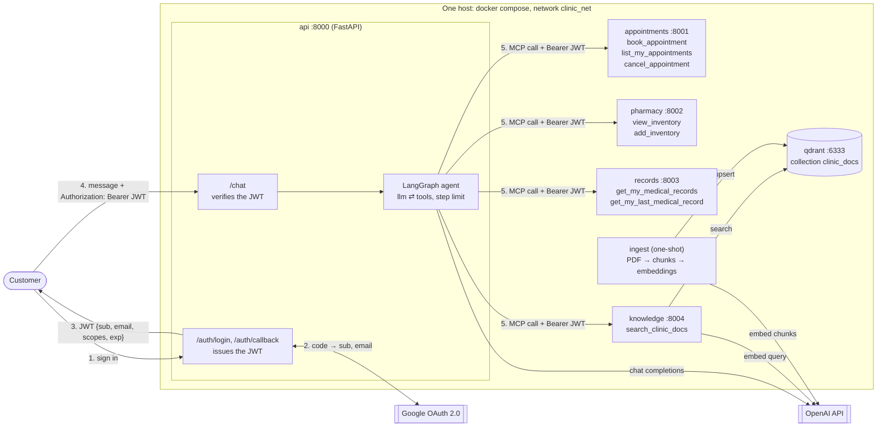
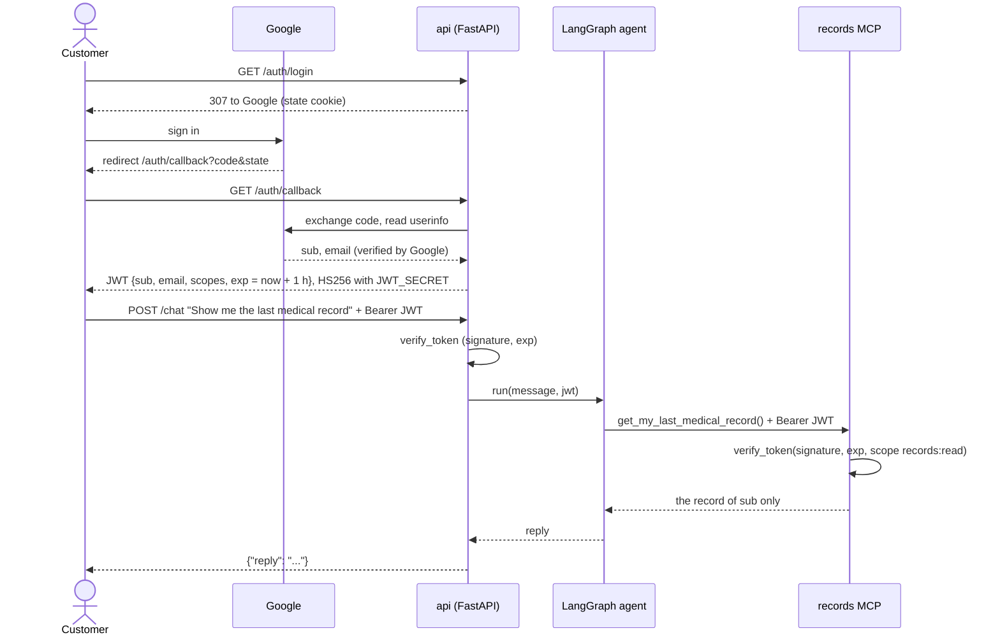

# Clinic Assistant v2: architecture (#314)

The agent decides **what** to do. Each MCP server owns **how** it is done, along with the data and
secrets for its domain. FastAPI signs the user in with Google and passes one signed JWT to every
tool call, so each server knows who is asking without ever trusting the chat text.

All names, ports and scopes below come from [`contract.md`](contract.md).

## System view

## One chat message, step by step

## Who trusts whom, and why

**Google** is the only party that proves who the customer is. FastAPI trusts the `sub` and `email`
that Google returns from the authorization-code exchange, because that exchange runs
server-to-server with our client secret. FastAPI turns that identity into a JWT, signed with
`JWT_SECRET`, that lives for one hour.

**Each MCP server** trusts a request only if its JWT has a valid HS256 signature, an `exp` in the
future and the scope that tool needs. Only FastAPI and the servers know `JWT_SECRET`, so nobody else
can make or change a token without breaking the signature. The servers share one host and one
Docker network with FastAPI, which is why a shared secret (rather than public-key signing) is
enough here.

**The agent and the LLM are never trusted with identity.** No tool takes a user id argument: every
personal-data tool reads the user from the token's `sub`. So even if a customer types "show me
user-b's records", the model has no way to ask for them. This is also why the assistant never needs
to ask "What's your ID?".

## Where each secret lives

| Secret | api | appointments | pharmacy | records | knowledge | ingest |
|---|---|---|---|---|---|---|
| `JWT_SECRET` | ✓ (sign + verify) | ✓ (verify) | ✓ (verify) | ✓ (verify) | ✓ (verify) | |
| `GOOGLE_CLIENT_ID`, `GOOGLE_CLIENT_SECRET` | ✓ | | | | | |
| `OPENAI_API_KEY` | ✓ (agent LLM) | | | | ✓ (embeddings) | ✓ (embeddings) |
| `QDRANT_URL`, `QDRANT_COLLECTION` | | | | | ✓ | ✓ |
| Domain data (appointments, stock, records) | | ✓ | ✓ | ✓ | | |

After the refactor, the API holds **no tool secrets**: it can't reach Qdrant or any domain data
except through an MCP tool, with the user's token.

## Code layout

| Folder | Contains | Item |
|---|---|---|
| `api/` | FastAPI app, OAuth routes, `/chat`, the LangGraph agent and its MCP clients | 6 |
| `servers/appointments/`, `servers/pharmacy/`, `servers/records/` | Domain FastMCP servers with in-memory seed data | 1, 2, 3 |
| `servers/knowledge/` | FastMCP server over Qdrant | 5 |
| `ingestion/` | PDFs and the re-runnable ingest job | 4 |
| `auth_reference/` | The shared `tokens.py` that every service copies | contract |
| `tests/` | Unit, token-rejection, isolation and end-to-end tests (fake LLM) | 7 |
| `docker-compose.yml` | All services on `clinic_net`, secrets from `.env` | 7 |
