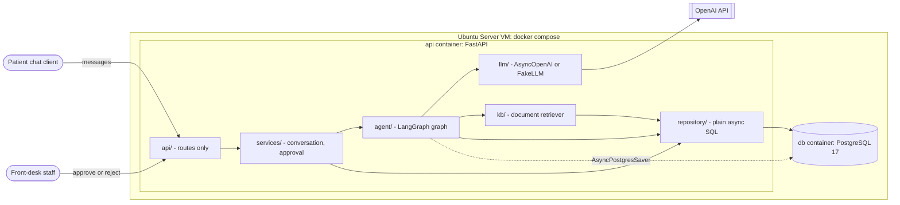
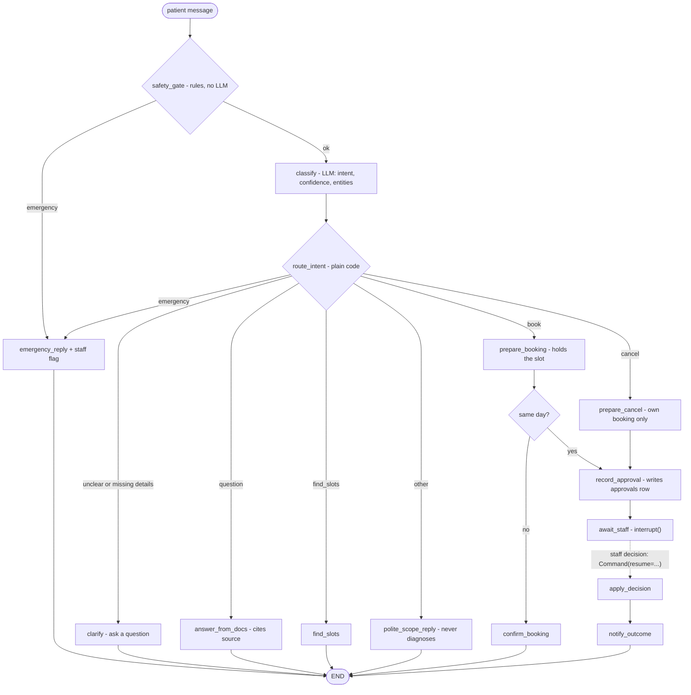
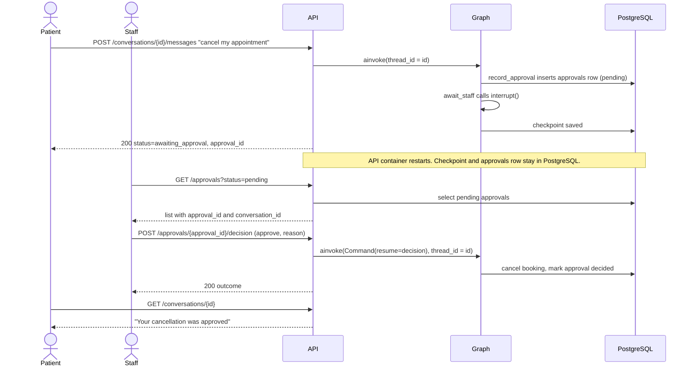
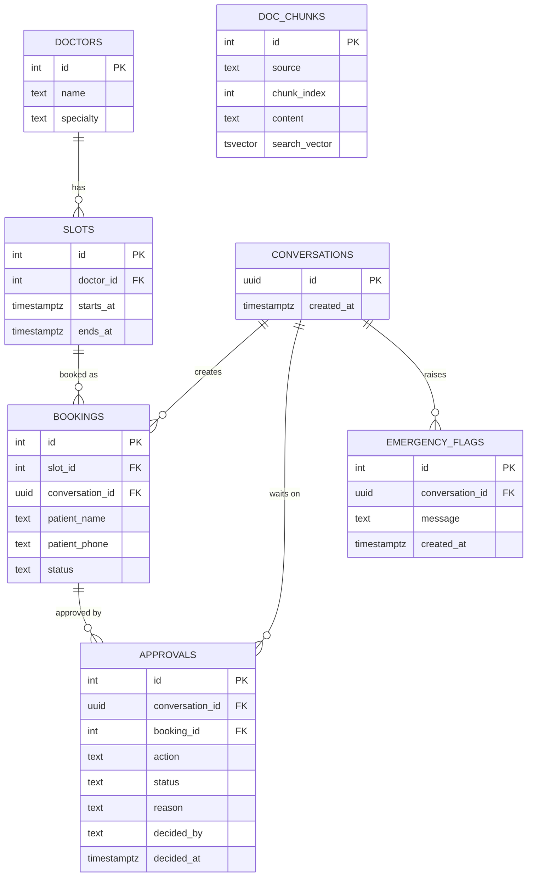
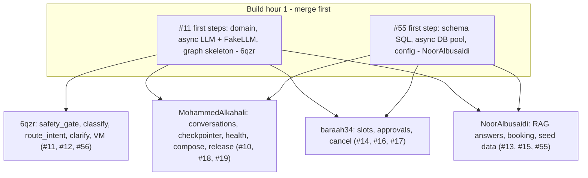

# Architecture

The Clinic Front-Desk Assistant is a REST API driven by one LangGraph workflow. It runs as two
Docker Compose services on the VM. The design follows the R1, R2 and R3 research spikes and the
decisions logged in #6. Each decision has an ADR in [`docs/adr/`](adr/).

**Principles**
1. **Code decides; the LLM understands and writes.** Emergency handling, intent routing and
   "needs staff approval" are plain functions ([ADR 0005](adr/0005-safety-and-routing-in-code.md)).
2. **One graph, one thread per conversation.** `thread_id = conversation_id`, checkpointed in
   PostgreSQL ([ADR 0001](adr/0001-postgres-checkpointer.md)).
3. **A pause is a real pause.** Risky actions stop at `interrupt()` and resume with the staff
   decision ([ADR 0002](adr/0002-approvals-interrupt-resume.md)).
4. **All I/O is async** ([ADR 0007](adr/0007-async-io.md)).

## 1. System view

| Layer | Responsibility | Rule |
|---|---|---|
| `api/` | HTTP routes, Pydantic validation, status codes, OpenAPI | No business logic; calls a service |
| `services/` | Runs the graph (`ainvoke`), maps state to responses, resumes approvals | Only layer that knows both API models and the graph |
| `agent/` | State, nodes, edges, routing | Nodes return only the keys they change; never import the OpenAI SDK |
| `llm/` | One async interface: `AsyncOpenAI` implementation + deterministic `FakeLLM` | Tests and CI use the fake only |
| `kb/` | Load and chunk clinic documents; full-text retrieval | Empty result is not an error |
| `repository/` | Parameterised SQL through psycopg `AsyncConnectionPool` | No ORM; PostgreSQL only |
| `config.py` | Settings from environment variables | Fail fast on missing `OPENAI_API_KEY` |

## 2. Conversation workflow

`record_approval` is a separate node **before** `await_staff`. On resume, LangGraph re-runs the
interrupted node from its start, so any write inside `await_staff` would happen twice (R2 finding).

### State: one writer per field

| Field | Written by |
|---|---|
| `messages` | service (patient input) and each reply node |
| `intent`, `confidence`, `entities` | `classify` |
| `emergency` | `safety_gate` / `emergency_reply` |
| `sources` | `answer_from_docs` |
| `slots_offered` | `find_slots` |
| `pending_action` | `prepare_booking` / `prepare_cancel` |
| `approval_id` | `record_approval` |
| `decision` | resume input → `apply_decision` |
| `reply` | the last node of each branch |

The checkpoint stores the full history. Only the last `MAX_HISTORY_MESSAGES` (from config) are sent to the model.

## 3. Staff approval across a restart

## 4. API design

| Method and path | Purpose | Success | Errors |
|---|---|---|---|
| `POST /api/v1/conversations` | Start a conversation | 201 `{conversation_id}` | — |
| `POST /api/v1/conversations/{id}/messages` | Send a message | 200 `{reply, status, sources, approval_id}` | 404, 409 awaiting approval, 422, 502 LLM, 503 DB |
| `GET /api/v1/conversations/{id}` | History and status | 200 | 404 |
| `GET /api/v1/doctors?specialty=` | List doctors | 200 | — |
| `GET /api/v1/slots?doctor_id=&specialty=&date=` | Free slots | 200 | 422 |
| `GET /api/v1/approvals?status=pending` | Staff queue | 200 | — |
| `POST /api/v1/approvals/{id}/decision` | Approve or reject with reason; resumes the graph | 200 `{outcome}` | 404, 409 already decided, 422 |
| `GET /api/v1/emergencies` | Flagged emergency messages | 200 | — |
| `GET /health` | Service and database reachable | 200 | 503 |

`status` in a message reply is one of: `answered`, `clarifying`, `awaiting_approval`, `emergency`.

## 5. Data model

- `bookings.status` is one of: `pending_approval`, `confirmed`, `cancelled`, `rejected`.
- A **partial unique index** on `bookings(slot_id) WHERE status IN ('pending_approval', 'confirmed')` makes double booking impossible, even for concurrent requests ([ADR 0006](adr/0006-double-booking-db-constraint.md)).
- `approvals.action` is `book` or `cancel`, and `approvals.status` is `pending`, `approved` or `rejected`.
- `doc_chunks.search_vector` is a generated `tsvector` column with a GIN index ([ADR 0003](adr/0003-rag-postgres-full-text-search.md)).
- The checkpointer creates its own tables (`checkpoints`, `checkpoint_blobs`, `checkpoint_writes`, `checkpoint_migrations`) through `setup()` at API start-up.

## 6. Slices and ownership

Two foundation tasks merge first. After that, each slice edits only its own files and connects to
the others through **state fields and tables**, never by importing a teammate's functions.

